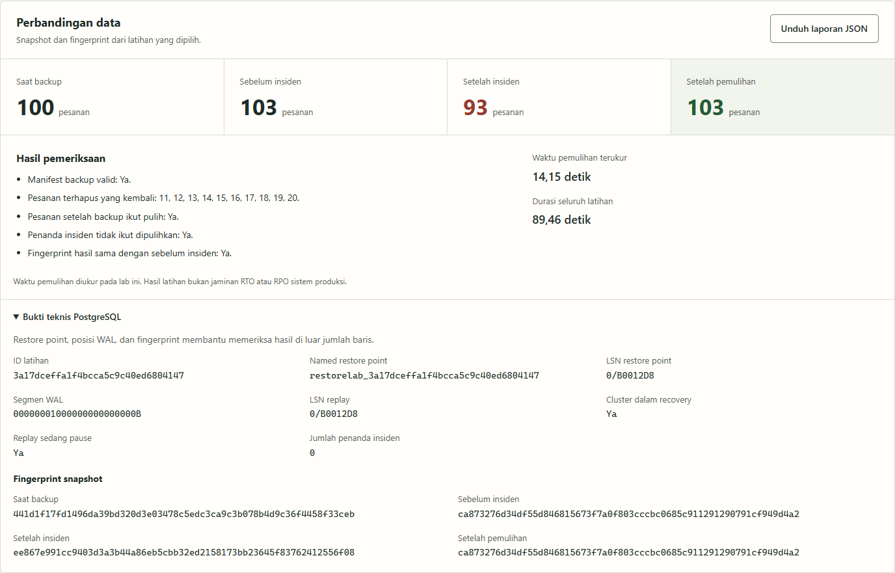
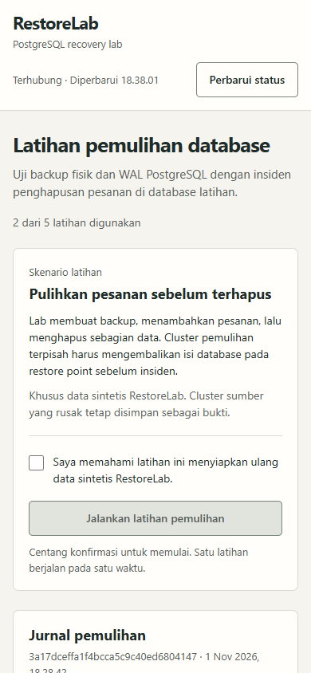

# RestoreLab

Latihan pemulihan PostgreSQL dengan **backup fisik, arsip WAL, dan named restore point**. Aplikasi Python lokal menjalankan insiden pada data sintetis, memulihkan backup ke cluster terpisah, lalu membandingkan hasilnya dengan data sebelum insiden.

Proyek ini menjawab satu pertanyaan: **backup yang berhasil dibuat bisa mengembalikan data yang kita perlukan atau belum?**



## Skenario yang dikerjakan

| Tahap | Isi data yang diharapkan |
|---|---|
| Base backup | 100 pesanan sintetis |
| Perubahan setelah backup | Tambah pesanan 101, 102, dan 103 |
| Titik pemulihan | Named restore point setelah tiga pesanan baru masuk |
| Insiden | Hapus pesanan 11 sampai 20, sehingga tersisa 93 pesanan |
| Pemulihan | Cluster terpisah kembali berisi 103 pesanan sebelum insiden |

Jumlah baris saja belum cukup. Engine juga memeriksa isi pesanan, SHA-256 snapshot, ID pesanan yang kembali, tiga pesanan setelah backup, marker latihan, posisi WAL, identitas cluster, dan marker insiden yang harus tidak ada pada hasil pemulihan. Cluster sumber tetap berisi data yang rusak sebagai pembanding.

## Jalankan di Windows

Kebutuhan:

- Python 3.13 tersedia melalui perintah `python`.
- Docker Desktop aktif dengan **Linux containers** dan Docker Compose.
- Koneksi internet saat image PostgreSQL pertama kali diunduh.
- Port lokal 8140 tersedia dan ruang disk untuk backup serta clone PostgreSQL.

Simpan proyek di drive data, misalnya D:. Jika sudah memiliki salinannya, gunakan folder tersebut. Untuk salinan baru:

```powershell
git clone https://github.com/zalamanga/restorelab.git
Set-Location .\restorelab
.\scripts\Start.ps1
```

Buka **[http://127.0.0.1:8140](http://127.0.0.1:8140)**. Script memeriksa Docker, menyiapkan secret lokal, lalu menjalankan controller di latar belakang. Tidak ada latihan yang dimulai otomatis.

1. Baca skenario pada halaman.
2. Centang konfirmasi bahwa latihan menyiapkan ulang **data sintetis RestoreLab**.
3. Klik **Jalankan latihan pemulihan**.
4. Ikuti sembilan fase pada jurnal. Image dan volume dibuat saat latihan pertama membutuhkannya.
5. Setelah **Terverifikasi**, buka perbandingan data, perluas **Bukti teknis PostgreSQL**, lalu unduh laporan JSON.

Tidak perlu `pip install` atau `npm install` untuk menjalankan aplikasi. Runtime controller memakai Python standard library. Node.js hanya diperlukan untuk pengujian browser.

Controller juga bisa dijalankan di terminal foreground, termasuk pada Linux dengan Docker:

```bash
python run.py --port 8140 --max-runs 5
```

Gunakan satu controller untuk instance lab ini. Jangan menjalankan dua clone repository sebagai dua lab bersamaan: nama project Docker sengaja tetap `restorelab`.

## Cara membaca hasil

| Bagian | Yang diperiksa |
|---|---|
| Jurnal pemulihan | Fase native terakhir, waktu kejadian, dan pesan engine |
| Riwayat latihan | Latihan aktif dan hasil sebelumnya, termasuk gagal atau terputus |
| Perbandingan data | Empat snapshot: 100, 103, 93, dan 103 pada skenario yang berhasil |
| Hasil pemeriksaan | Manifest backup, pesanan yang kembali, perubahan setelah backup, dan pengecualian insiden |
| Bukti teknis | Named restore point, target/replay LSN, segmen WAL, status pause, dan fingerprint |
| Laporan JSON | Bukti terstruktur dari latihan terverifikasi, diunduh langsung dari backend |

[Lihat screenshot jurnal pemulihan lengkap](docs/screenshots/02-verified.png).

`pg_verifybackup` memeriksa integritas backup, sedangkan pemulihan clone dan pemeriksaan data menguji hasil penggunaannya. Keduanya dikerjakan; pemeriksaan manifest sendiri tidak menerbitkan status berhasil.

## Berhenti dan lanjutkan

Tunggu latihan selesai, lalu jalankan:

```powershell
.\scripts\Stop.ps1
```

Script menghentikan controller milik proyek ini dan container RestoreLab, sambil mempertahankan ledger, backup, WAL, serta data recovery. Menjalankan `Start.ps1` kembali akan membuka riwayat yang sama.

`Stop.ps1` menolak berhenti jika masih ada latihan aktif. Jika memang perlu menghentikan latihan yang belum selesai:

```powershell
.\scripts\Stop.ps1 -Interrupt
```

Latihan yang tertinggal `queued` atau `running` ditandai **Terputus** saat controller berikutnya mulai. Latihan tersebut tidak dilanjutkan atau diulang otomatis. Periksa catatan dan container lokal sebelum membuat latihan baru; tools native yang masih berjalan akan membuat engine menolak memulai pekerjaan berikutnya.

## Data dan penyimpanan

| Lokasi | Isi |
|---|---|
| `.data/controller.sqlite` | Ledger latihan, request ID, kejadian, dan laporan |
| `.secrets/postgres_password` | Password PostgreSQL yang dibuat lokal; jangan dipublikasikan |
| `.runtime/` | Identitas proses server untuk script Windows |
| `.local/` | Log dan diagnostik lokal yang tidak masuk Git |
| Volume `restorelab_primary_data` | Cluster sumber dengan fixture sintetis |
| Volume `restorelab_backups` | Base backup per ID latihan |
| Volume `restorelab_wal_archive` | Arsip WAL milik cluster lab |
| Volume `restorelab_recovery_data` | Clone pemulihan per ID latihan |

Default batas controller adalah **5 percobaan**, termasuk latihan gagal dan terputus. Penghitungan berasal dari ledger, sehingga restart server tidak mengosongkannya. Batas membantu menahan pertumbuhan backup dan clone; aplikasi tidak melakukan prune otomatis.

Operator bisa memilih `Start.ps1 -MaxRuns N` saat controller belum berjalan, dengan rentang 1 sampai 50. Menambah batas berarti mengizinkan lebih banyak data tersimpan. Start pada controller yang sudah aktif memakai proses yang ada; hentikan dahulu jika perlu mengubah konfigurasi.

Lokasi repository menentukan lokasi file controller, sedangkan volume Docker disimpan di lokasi disk Docker Desktop. Menaruh repository di D: tidak otomatis memindahkan disk Docker dari C:. Jangan menghapus volume atau secret untuk mengatasi error tanpa memeriksa bukti yang perlu disimpan.

## API lokal

| Metode | Route | Fungsi |
|---|---|---|
| GET | `/health` | Kesehatan proses controller, bukan bukti kesiapan PostgreSQL atau keberhasilan restore |
| GET | `/api/state` | Quota, riwayat, dan latihan aktif |
| GET | `/api/runs/<run_id>` | Detail satu latihan beserta kejadian |
| POST | `/api/runs` | Buat latihan atau kembalikan latihan dari request ID yang sama |
| GET | `/api/runs/<run_id>/report` | Unduh laporan jika latihan terverifikasi |

Payload POST selalu berupa skenario tetap:

```json
{
  "request_id": "<32 karakter heksadesimal kecil yang dibuat client>",
  "scenario": "delete_orders",
  "acknowledge": "SYNTHETIC_ONLY"
}
```

Server mengembalikan `202` untuk latihan baru dan `200` untuk request ID yang telah diterima sebelumnya. `409` berarti ada latihan aktif, batas tercapai, atau laporan belum tersedia. Client mempertahankan request ID ketika hasil pengiriman belum diketahui agar retry tidak membuat latihan kedua.

Mutation memerlukan `Host` lokal yang diizinkan, `Origin` yang sama, dan JSON UTF-8 dengan bentuk tepat. Server terikat pada `127.0.0.1`; tidak ada login aplikasi. Ini adalah workstation lokal untuk satu operator, sehingga jangan mengekspos port melalui jaringan publik atau tunnel.

## Pengujian

Tes controller, ledger, dan HTTP memakai engine test terisolasi; tidak menjalankan insiden PostgreSQL:

```powershell
.\scripts\Test.ps1
```

Untuk ringkasan JSON:

```powershell
python tests/run_unit.py
```

Tes native berikut **membuat satu latihan nyata dan menggunakan satu jatah controller**. Jalankan setelah server aktif:

```powershell
python tests/native_verify.py
```

Pemeriksaan negatif menyalin backup dari hasil tes native, merusak file pada **salinan terpisah**, lalu memastikan `pg_verifybackup` menolaknya. Backup asli diperiksa kembali. Salinan negatif tetap memakai ruang disk dan tidak dihitung sebagai job controller:

```powershell
python tests/native_corruption.py
```

Untuk browser, gunakan Node.js 22.14.0, jalankan server, lalu:

```powershell
npm ci --ignore-scripts --cache .local/npm-cache
npm run test:browser
npm run screenshots
```

Pengujian lokal memakai Microsoft Edge; CI memakai Chromium. Suite browser memuat tes fixture yang berlabel **UI fixture** untuk kondisi jaringan, quota, race response, keyboard, dan ukuran layar, serta tes yang benar-benar menjalankan latihan native. Screenshot publik memerlukan hasil PostgreSQL terverifikasi dan tidak memulai latihan tambahan. Lihat [catatan verifikasi](docs/VERIFICATION.md) untuk hasil pengujian yang sudah dijalankan, versi, dan cakupannya.

## Batas proyek

- Skenario, database, tabel latihan, dan restore point ditentukan oleh engine. Tidak ada SQL bebas, upload backup, URL database pengguna, atau pemulihan ke timestamp pilihan.
- Snapshot/fingerprint membuktikan isi **pesanan latihan** dan pemeriksaan yang dicatat. Proyek tidak mengklaim semua objek database, file eksternal, atau perilaku aplikasi bisnis identik.
- Clone berhenti pada target dalam recovery yang sedang pause. Proyek tidak melakukan promosi, failover, atau pengalihan trafik aplikasi produksi.
- Waktu pemulihan memakai monotonic clock pada lab ini. Ukurannya mencakup persiapan clone sampai pemeriksaan hasil; bukan angka replay WAL saja dan bukan jaminan RTO/RPO produksi.
- Tidak ada enkripsi backup aplikasi, replikasi ke lokasi lain, jadwal backup, kebijakan retensi otomatis, ataupun pengelolaan banyak pengguna.
- Marker dan identitas cluster membatasi operasi ke lab sintetis, tetapi bukan pengganti rancangan hak akses dan operasi database produksi.
- Role PostgreSQL `restorelab` dibuat sebagai superuser oleh image PostgreSQL untuk lab terisolasi ini. Ini bukan contoh pembagian akun dengan hak minimum untuk produksi; peran aplikasi, backup/replikasi, dan operator perlu dipisahkan pada rancangan produksi.

## Panduan kode dan presentasi

- [CODE-GUIDE.md](docs/CODE-GUIDE.md): baca alur dari request HTTP sampai PostgreSQL, per file dan fungsi.
- [INTERVIEW.md](docs/INTERVIEW.md): urutan demo dan jawaban teknis dengan batas klaim yang jelas.
- [CONTRACT.md](docs/CONTRACT.md): kontrak antar controller, engine native, dan UI.
- [DESIGN.md](DESIGN.md): alasan layout, warna, dan interaksi workstation.


