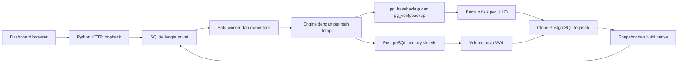

# Arsitektur dan alur data

## Ledger dan eksekusi

SQLite mencatat permintaan, status, timestamp, urutan event, error aman dan laporan terminal. Transaksi `BEGIN IMMEDIATE` menyerialkan pemeriksaan deduplikasi, satu latihan aktif, quota dan insert. Unique request ID dan unique index pada status aktif menjadi pengaman tambahan. Koneksi SQLite ditutup secara eksplisit; snapshot state dibaca dalam satu transaksi.

File lock OS mencegah controller kedua memakai direktori data yang sama. Worker mengambil satu job, menjalankan Engine, lalu memvalidasi struktur serta invariannya sebelum menerbitkan verified. Semua job lama yang belum selesai ditandai interrupted saat startup; tidak ada replay native otomatis. Pemeriksaan container tools aktif mencegah pekerjaan lama yang masih berjalan beradu dengan latihan baru setelah crash.

## PostgreSQL

Image PostgreSQL 17 dipatok dengan digest. Primary, archive, backup dan recovery mempunyai volume bernama tersendiri. Primary tidak membuka port host; recovery menggunakan Unix socket internal. Role `restorelab` adalah superuser di cluster sintetis khusus ini agar operasi physical backup dan restore point dapat diuji. Konfigurasi ini bukan contoh pembatasan hak untuk produksi. Secret dibuat lokal dan tidak masuk Git/HTTP/artifact.

Primary memeriksa nama database, role, versi major, marker schema, active run dan system identifier sebelum operasi penulisan. Script volume/backup/clone memeriksa marker serta UUID, menolak target yang sudah ada, dan tidak menerima path dari browser. Source tidak menggunakan URL database atau SQL yang dikirim pengguna.

Physical backup menyimpan kondisi awal cluster. WAL setelah backup membawa tiga transaksi baru, restore point dan insiden. Recovery memakai `recovery.signal`, `restore_command` dari arsip khusus, target bernama dan aksi pause. Clone tetap read-only pada target. Source primary tetap menyimpan bukti kerusakan sintetis; tidak dialihkan menjadi clone hasil pemulihan.

Manifest verification memeriksa integritas backup fisik. Pemulihan dan pembandingan data dijalankan terpisah karena manifest yang valid saja tidak membuktikan isi hasil restore. Fingerprint dibentuk dari JSON pesanan yang diurutkan menurut ID dengan serialisasi kanonis. System identifier, active run, native pause, LSN, sepuluh ID, tiga baris pascabackup dan pengecualian marker insiden juga diperiksa.

## Perimeter HTTP

Server mengikat `127.0.0.1`, memeriksa Host aktual dan Origin yang cocok untuk POST, menolak framing/JSON ambigu, serta melayani hanya tiga aset statis dan route API yang ditentukan. Tidak ada endpoint reset volume, SQL editor, upload, arbitrary command, atau akses file generik. CSP membatasi script/style/connect ke origin sendiri. Nilai remote ditampilkan dengan `textContent`.

Scope ini adalah workstation lokal dengan data sintetis. Proses lokal yang tepercaya tetap memiliki kemampuan Docker pengguna; aplikasi bukan boundary untuk melawan malware lokal atau pengganti autentikasi layanan publik.

## Penyimpanan dan restart

Ledger di `.data/`, secret di `.secrets/`, PID runtime di `.runtime/`, dan diagnostik di `.local/` tidak dipublikasikan. Volume PostgreSQL/backup/WAL/clone bertahan setelah Stop. Pengukuran durasi memakai clock monotonic, sedangkan waktu event ditampilkan sebagai UTC yang diformat browser.

Histori verified menunjukkan hasil pemeriksaan pada timestamp job tersebut. Restart tidak menguji ulang atau mempromosikan clone lama secara otomatis. Latihan baru membuat backup dan clone UUID baru. Menghapus direktori controller tidak membersihkan volume Docker dan tidak boleh dianggap sebagai prosedur reset lab yang lengkap.
