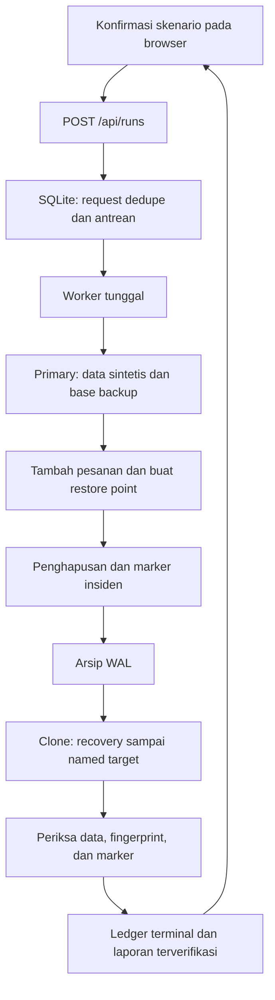

# Membaca dan membuat RestoreLab dari awal

Panduan ini mengikuti kode yang ada di repository. Tujuannya supaya kamu memahami alasan setiap bagian, bisa menjelaskan alurnya, lalu mengubah bagian yang tepat ketika mengembangkan proyek.

## 1. Pahami pekerjaan yang akan dibuktikan

Database latihan memiliki 100 pesanan. Kita membuat physical backup, lalu memasukkan tiga pesanan baru. Sesudah itu kita membuat named restore point, menghapus sepuluh pesanan, dan mencatat marker insiden.

Jika hanya menyalin kembali base backup, hasilnya 100 pesanan dan tiga pesanan baru hilang. Karena itu PostgreSQL perlu memutar ulang WAL sampai titik sebelum penghapusan. Hasil yang diharapkan adalah 103 pesanan, termasuk pesanan baru dan sepuluh pesanan yang dihapus. Marker insiden harus tidak ikut masuk.

RestoreLab melakukan pemulihan pada clone terpisah. Sumber tetap rusak sehingga hasil sumber dan clone bisa dibandingkan.



## 2. Peta file

| File | Tanggung jawab |
|---|---|
| [`run.py`](../run.py) | Entry point Python |
| [`restorelab/server.py`](../restorelab/server.py) | HTTP, validasi perimeter, penyajian asset, dan argumen CLI |
| [`restorelab/service.py`](../restorelab/service.py) | Lock kepemilikan, worker, validasi laporan, dan lifecycle pekerjaan |
| [`restorelab/store.py`](../restorelab/store.py) | Ledger SQLite, dedupe, quota, transisi state, dan event |
| [`restorelab/engine.py`](../restorelab/engine.py) | Orkestrasi Docker/PostgreSQL dan pembuktian hasil |
| [`compose.yaml`](../compose.yaml) | Primary, tools, recovery, secret, resource limit, dan volume |
| [`infrastructure/`](../infrastructure/) | Script yang dijalankan di container PostgreSQL |
| [`scripts/Common.ps1`](../scripts/Common.ps1) | Pembungkus command native dan pemeriksaan exit code pada PowerShell |
| [`scripts/`](../scripts/) | Start, stop, dan tes dari PowerShell |
| [`www/`](../www/) | HTML, CSS, dan JavaScript untuk workstation |
| [`tests/`](../tests/) | Unit, native integration, negatif backup, dan browser |

`restorelab/__init__.py` membuat direktori tersebut menjadi package Python. Runtime tidak membutuhkan framework HTTP atau library database tambahan: SQLite, HTTP server, threading, JSON, subprocess, dan hashing tersedia pada standard library.

## 3. Mulai dari entry point dan server

[`run.py`](../run.py) mengimpor `main` dari [`server.py`](../restorelab/server.py), lalu menjalankannya jika file dipanggil langsung.

`main()` membaca `--port` dan `--max-runs`, membuat `Service`, memulai worker, lalu membuat HTTP server. `make_server()` menolak bind selain `127.0.0.1`. Saat proses berhenti melalui signal yang ditangani, server ditutup dan service diminta berhenti.

`Server` mewarisi `ThreadingHTTPServer`. Setiap request dapat ditangani thread HTTP tersendiri, tetapi pekerjaan PostgreSQL tetap ditangani satu worker.

Fungsi penting pada `Handler`:

| Fungsi | Yang dikerjakan |
|---|---|
| `setup()` | Memberi timeout koneksi agar request tidak menunggu tanpa batas |
| `_perimeter(mutation=False)` | Memeriksa satu header Host, URL lokal, dan melarang query/fragment/path berbentuk URL lain |
| `_perimeter(mutation=True)` | Menambahkan pemeriksaan Origin dan `Sec-Fetch-Site` pada perubahan state |
| `_reply()` | Mengirim body, tipe konten, panjang, no-store, nosniff, CSP, dan header tambahan |
| `_error()` | Menggunakan bentuk JSON error yang konsisten |
| `do_GET()` | Melayani status, detail, laporan, atau tiga asset yang diizinkan |
| `do_POST()` | Membaca dan memvalidasi JSON untuk satu route pembuatan latihan |
| `_unique_object()` | Menolak JSON dengan nama property ganda |

POST hanya menerima tiga property: `request_id`, `scenario`, dan `acknowledge`. Ukuran body dibatasi 4.096 byte. Scenario harus `delete_orders`, acknowledge harus `SYNTHETIC_ONLY`, dan request ID harus 32 karakter hex kecil. Tidak ada property untuk SQL, nama database bebas, path backup, atau command Docker.

GET tidak memulai latihan. `/health` menjawab kesehatan proses controller; respons itu tidak menjamin PostgreSQL sudah berjalan atau backup berhasil dipulihkan.

## 4. Buat ledger pekerjaan yang tahan restart

[`Store`](../restorelab/store.py) membuka SQLite pada `.data/controller.sqlite`. Ada dua tabel utama:

| Tabel | Isi |
|---|---|
| `runs` | Identitas, request ID unik, scenario, status, fase terakhir, waktu, error, dan laporan |
| `events` | Kejadian berurutan untuk tiap latihan, beserta waktu dan detail |

Unique index `one_active_run` hanya berlaku untuk status `queued` dan `running`. Dengan begitu database sendiri membatasi satu pekerjaan aktif, bukan hanya pengecekan pada browser.

`_connect()` mengaktifkan foreign key dan busy timeout. Koneksi ditutup setelah dipakai; transaksi yang belum selesai di-rollback. Journal mode SQLite adalah WAL, yang berbeda dari WAL PostgreSQL untuk skenario recovery. Keduanya bernama WAL tetapi digunakan oleh dua database yang berbeda.

### Fungsi `create()`

Urutannya berada dalam satu `BEGIN IMMEDIATE`:

1. Cari request ID yang sama. Jika ada, kembalikan pekerjaan sebelumnya.
2. Tolak jika ada pekerjaan aktif.
3. Hitung seluruh percobaan dalam ledger dan periksa quota.
4. Buat run ID baru dengan `uuid.uuid4().hex`, lalu simpan status `queued`.
5. Commit sebelum HTTP mengembalikan hasil.

Dedupe diperiksa sebelum batas aktif/quota. Karena itu retry atas permintaan yang sudah diterima tetap dapat menemukan hasil asalnya. Status gagal dan terputus tetap memakai jatah karena masing-masing mungkin sudah membuat data atau backup.

### Fungsi lainnya

| Fungsi | Alasan dipisahkan |
|---|---|
| `claim()` | Memindahkan satu pekerjaan dari `queued` ke `running` dalam transaksi |
| `append_event()` | Memvalidasi fase, membatasi pesan/detail, memberi sequence, dan memperbarui fase terakhir |
| `finish()` | Menutup pekerjaan menjadi `verified`, `failed`, atau `interrupted`; hanya hasil terverifikasi memiliki laporan |
| `interrupt_running()` | Menandai pekerjaan lama yang masih antre/berjalan sebagai terputus saat startup |
| `get()` | Mengambil detail satu pekerjaan |
| `list_runs()` | Mengambil riwayat dari yang terbaru |
| `state()` | Mengambil daftar dan pekerjaan aktif dalam snapshot transaksi yang sama |
| `_detail()` | Mengubah row SQLite menjadi envelope JSON dan menggabungkan event |
| `utc_now()` | Mencatat waktu UTC yang konsisten |

`append_event()` dan `finish()` menolak perubahan pada pekerjaan terminal. Bukti akhir tidak diperlakukan sebagai draft yang boleh ditimpa setelah selesai.

## 5. Hubungkan ledger dengan worker

[`service.py`](../restorelab/service.py) menjadi penghubung HTTP dan engine.

`OwnerLock.acquire()` menggunakan file lock: `msvcrt` di Windows atau `fcntl` pada Linux. Lock membuat satu controller memiliki direktori ledger. Ini berbeda dari unique index satu pekerjaan aktif dan dari lock native engine; tiap lapisan melindungi keadaan yang berbeda.

`Service.start()` mengambil owner lock, menandai job lama sebagai `interrupted`, lalu membuat thread worker. Job lama tidak dieksekusi ulang otomatis.

`enqueue()` memastikan service belum berhenti dan thread worker tersedia sebelum meminta `Store.create()`. Setelah itu `_wake` memberi tahu worker bahwa ada pekerjaan.

`_work()` menjalankan loop berikut:

```python
run = self.store.claim()
report = self.engine.execute(run_id, emit)
validate_report(report, run_id)
self.store.finish(run_id, "verified", report=report)
```

Cuplikan di atas menunjukkan jalur berhasil; implementasi lengkap juga menangani antrean kosong, permintaan stop, serta error. Callback `emit()` menyimpan kejadian ke ledger dan dapat menghentikan pekerjaan sebelum fase berikutnya saat service diminta berhenti.

`validate_report()` memeriksa kembali envelope laporan dari engine: ID, scenario, strategi, jumlah dan fingerprint snapshot, marker, LSN, hasil temuan, dan durasi finite yang tidak negatif. Engine tidak cukup hanya mengembalikan `verified: true`.

`get_report()` hanya mengembalikan laporan dari pekerjaan berstatus `verified`. `state()` menambahkan status ketersediaan worker. `close()` meminta worker berhenti dan menunggu; operasi native yang sedang berlangsung tidak selalu dapat dibatalkan seketika, sehingga bukti terputus dan pemeriksaan proses berikutnya tetap diperlukan.

## 6. Siapkan Docker dan identitas lab

[`compose.yaml`](../compose.yaml) memiliki tiga service:

| Service | Pekerjaan |
|---|---|
| `primary` | Cluster sumber PostgreSQL 17 dengan archiving aktif |
| `tools` | Container sekali pakai untuk base backup, manifest verification, dan persiapan clone |
| `recovery` | Cluster clone pada profile `recovery`, membaca arsip WAL sampai target |

Tidak ada port PostgreSQL yang dipublikasikan ke host. Controller memakai `docker compose exec` untuk `psql`, dan tools mengakses primary lewat jaringan Compose. Password dibaca dari secret file, bukan dimasukkan ke command HTTP atau source Git.

Secret host memakai mode `0600`. Karena [file-sourced secret Compose memakai bind mount](https://docs.docker.com/reference/compose-file/services/#long-syntax-3) dan mengabaikan pemetaan UID/GID/mode, hanya startup `backup.sh` berjalan sebagai root untuk membacanya pada Linux. Script kemudian menurunkan UID ke `postgres` dengan `gosu` atau `su-exec`, membawa `PGPASSWORD` melalui environment. Query dan `pg_basebackup` tetap berjalan sebagai `postgres`. Tools selain backup tidak mendapat pengecualian pengguna ini.

`POSTGRES_USER=restorelab` pada image PostgreSQL membuat role SQL `restorelab` sebagai **superuser**. Pilihan ini menyederhanakan operasi cluster pada lab sintetis yang terisolasi, termasuk pembacaan identitas cluster. Ini tidak mengajarkan least privilege produksi. Rancangan produksi perlu memisahkan akun aplikasi, backup/replikasi, dan operator, lalu memberi hanya privilege yang diperlukan masing-masing.

Image PostgreSQL dipin ke digest. Backup dan recovery memakai versi mayor yang sama, dengan batas memori per service. Nama project adalah `restorelab`, sehingga semua perintah engine menunjuk stack yang sama.

[`bootstrap.py`](../infrastructure/bootstrap.py) membuat secret hanya jika belum ada. Jika volume RestoreLab sudah ada tetapi secret hilang, script menolak membuat password pengganti. Password baru tanpa memperbarui database lama akan menyebabkan masalah autentikasi.

[`init-volumes.sh`](../infrastructure/init-volumes.sh) membuat marker untuk volume arsip, backup, dan recovery. Direktori nonkosong yang tidak memiliki marker yang benar ditolak. [`init-primary.sh`](../infrastructure/init-primary.sh) membuat schema, tabel fixture, marker primary, identitas system ID, serta aturan akses replikasi yang diperlukan `pg_basebackup`.

Tabel `restorelab.instance_guard` mengikat database ke lab dan active run. `run_registry` menyimpan run ID yang pernah dipakai; `orders` berisi fixture; `incidents` membuktikan operasi penghapusan terjadi setelah target.

## 7. Baca engine dari pembungkus command dahulu

[`Engine`](../restorelab/engine.py) menerima root repository, bukan URL database dari HTTP.

| Fungsi | Tanggung jawab |
|---|---|
| `_command()` | Menjalankan daftar argumen tanpa membentuk shell command bebas, memberi timeout, dan mengubah kegagalan menjadi error aman |
| `_record_native_error()` | Menulis diagnostik lokal terbatas dan menyamarkan secret yang dikenal |
| `_compose()` | Mengunci nama project, file Compose, dan direktori proyek |
| `_tools()` | Menjalankan script tools pada container sekali pakai |
| `_sql()` | Menjalankan `psql` pada service tetap dengan `ON_ERROR_STOP` |
| `_json_sql()` | Membaca hasil query JSON, menolak bukti yang tidak bisa dibaca |
| `_guard()` | Membentuk pemeriksaan database, user, versi mayor, primary, lab ID, serta active run |
| `_assert_primary()` | Menjalankan guard dan mencocokkan system ID cluster dengan marker arsip |
| `_snapshot()` | Membaca pesanan terurut, memeriksa run ID, lalu menghitung SHA-256 JSON kanonis |
| `verify_backup()` | Menjalankan pemeriksaan manifest native untuk run ID yang valid |
| `execute()` | Memvalidasi run ID dan mengambil lock eksekusi engine |
| `_execute()` | Menjalankan sembilan fase latihan dan mengembalikan laporan |
| `health()` | Pemeriksaan murah terhadap akses Compose; tidak menggantikan verifikasi latihan |

Semua query mutasi ditulis oleh engine dan menggunakan identitas run yang sudah tervalidasi. Marker lab bukan otorisasi untuk mengarahkan engine ke database produksi. Interface HTTP memang tidak menyediakan pilihan target tersebut.

## 8. Ikuti sembilan fase native

### `prepare`

Engine memeriksa tools lama yang masih berjalan, menyiapkan secret dan volume, menyalakan primary, lalu memeriksa identitasnya. Dalam transaksi, engine mendaftarkan run, memasang active run, membersihkan fixture `orders`/`incidents`, dan membuat 100 pesanan sintetis. Snapshot pertama harus berjumlah 100.

Pembersihan fixture ini memang bagian dari skenario. Hanya database lab tetap yang sudah lolos guard yang boleh menerimanya.

### `backup`

[`backup.sh`](../infrastructure/backup.sh) memastikan direktori backup run belum ada dan identitas sesuai. Script menjalankan:

```bash
pg_basebackup -h primary -U restorelab -w \
  -D "$directory/base" --format=plain --wal-method=stream \
  --checkpoint=fast --manifest-checksums=SHA256
```

Ini adalah physical backup cluster. `--wal-method=stream` memasukkan WAL yang diperlukan untuk konsistensi base backup; perubahan sesudah backup membutuhkan arsip WAL pada fase berikutnya.

### `verify_backup`

[`verify-backup.sh`](../infrastructure/verify-backup.sh) memeriksa marker run dan menjalankan `pg_verifybackup --exit-on-error`. Kegagalan menghentikan jalur berhasil. Pemeriksaan ini belum membuktikan pemulihan ke target tertentu.

### `changes`

Engine menambahkan pesanan ID 101, 102, dan 103 sesudah backup. Snapshot sebelum insiden menjadi 103. Tiga row ini membuktikan nanti bahwa hasil berasal dari base backup **ditambah replay WAL**, bukan base backup saja.

### `restore_point`

`pg_create_restore_point()` membuat nama `restorelab_<run_id>`. Engine menyimpan target LSN dan segmen WAL yang memuat posisi target. Snapshot sebelum insiden menjadi pembanding isi data.

### `incident`

Engine menghapus pesanan ID 11 sampai 20 dan menulis marker ke `restorelab.incidents`. Sumber sekarang memiliki 93 pesanan. Posisi WAL setelah insiden dicatat supaya engine bisa memeriksa bahwa replay clone belum melewatinya.

### `archive`

Engine meminta `pg_switch_wal()` agar WAL relevan ditutup dan diarsipkan. [`archive-wal.sh`](../infrastructure/archive-wal.sh) memeriksa nama file, marker, dan system ID sebelum menyalin. File arsip yang sudah ada harus identik, bukan ditimpa begitu saja.

[`check-archive.sh`](../infrastructure/check-archive.sh) memastikan segmen target tersedia dan backup berasal dari cluster yang sama. Penantian dibatasi waktu.

### `recover`

Engine menghentikan service recovery lama, lalu [`prepare-recovery.sh`](../infrastructure/prepare-recovery.sh) menyalin backup ke direktori clone baru khusus run. Script menolak target yang sudah ada.

Konfigurasi yang ditambahkan:

```conf
restore_command = '/bin/sh /opt/restorelab/restore-wal.sh %f %p'
recovery_target_name = 'restorelab_<run_id>'
recovery_target_action = 'pause'
recovery_target_timeline = 'current'
primary_conninfo = ''
```

File `recovery.signal` membuat PostgreSQL masuk archive recovery. [`start-recovery.sh`](../infrastructure/start-recovery.sh) memeriksa path dan marker sebelum menjalankan postgres. [`restore-wal.sh`](../infrastructure/restore-wal.sh) memasok WAL dari arsip yang cocok dengan system ID clone.

Engine menunggu sampai cluster menyatakan masih dalam recovery dan replay benar-benar pause. Nama target, rentang LSN terhadap insiden, active run, dan system ID diperiksa. Tidak ada promosi cluster ke primary.

### `verify`

Engine membaca snapshot clone dan membandingkannya dengan sebelum insiden. Keberhasilan mensyaratkan:

- Jumlah snapshot adalah 100, 103, 93, dan 103.
- Fingerprint dan row pesanan clone sama persis dengan sebelum insiden.
- Sumber masih cocok dengan snapshot rusak.
- ID yang pulih adalah 11 sampai 20.
- Ketiga pesanan baru cocok dengan snapshot sebelum insiden.
- Marker insiden ada pada sumber tetapi tidak ada pada clone.
- Identitas cluster, target, active run, serta kondisi recovery sesuai.

Laporan baru dikembalikan jika semuanya benar. Fingerprint ini mencakup data pesanan yang dipilih `_snapshot()`, bukan seluruh objek dan file database.

## 9. Tampilkan pekerjaan yang benar-benar berjalan

[`index.html`](../www/index.html) berisi struktur halaman, form konfirmasi, jurnal, riwayat, perbandingan, dan disclosure bukti. [`styles.css`](../www/styles.css) mengatur workstation terang pada tiga rentang layout, fokus keyboard, target kontrol, dan wrapping identifier panjang.

[`app.js`](../www/app.js) membaca API dan tidak menjalankan SQL atau Docker:

| Fungsi | Perannya |
|---|---|
| `api()` | Fetch JSON dengan timeout dan pesan error yang dapat ditampilkan |
| `refresh()` | Mengambil state, mendeteksi request yang sudah diterima, dan memuat latihan terpilih |
| `scheduleRefresh()` | Poll lebih cepat saat aktif, lebih lambat saat idle, dan mencoba ulang saat offline |
| `updateControls()` | Menyesuaikan tombol dari konfirmasi, quota, status aktif, dan koneksi |
| `selectRun()` | Memuat riwayat dengan generation counter supaya respons lama tidak menimpa pilihan terbaru |
| `renderHistory()` | Memperbarui row tanpa mengganti tombol yang sedang mendapat fokus |
| `renderTimeline()` / `renderEvents()` | Menampilkan fase dan kejadian dari backend |
| `renderReport()` | Menampilkan snapshot, temuan, durasi, LSN, dan fingerprint |
| `savePendingRequest()` | Menyimpan request ID pada sessionStorage agar hasil POST yang belum diketahui bisa dicari atau dikirim ulang dengan identitas sama |

Nilai server dimasukkan sebagai `textContent`, termasuk pesan error dan bukti teknis. Data tidak dirangkai sebagai HTML. Tautan laporan hanya muncul setelah status dan laporan sama-sama terverifikasi.

## 10. Operasi dan pengujian

[`Common.ps1`](../scripts/Common.ps1) menyediakan `Invoke-RestoreNative`. Start, stop, dan test memakai pembungkus ini untuk menjalankan executable lalu memeriksa `$LASTEXITCODE`. Sementara command native berjalan, helper memakai `ErrorActionPreference=Continue` dan mengembalikan preferensi sebelumnya dalam `finally`. Ini menghindari salah menganggap output stderr biasa sebagai kegagalan pada PowerShell; exit code yang tidak nol tetap melempar error.

[`Start.ps1`](../scripts/Start.ps1) memeriksa Docker Linux, membuat secret jika sesuai, menjalankan controller dengan log lokal, memeriksa PID respons health, dan menyimpan identitas proses. Tidak ada job otomatis saat startup.

[`Stop.ps1`](../scripts/Stop.ps1) memeriksa root, command line, dan waktu mulai proses sebelum menghentikannya. Latihan aktif ditolak kecuali operator memilih `-Interrupt`. Volume tetap dipertahankan. Script ini tidak menjalankan `docker system prune` atau `down -v`.

[`Test.ps1`](../scripts/Test.ps1) menjalankan unit test Python. [`run_unit.py`](../tests/run_unit.py) menambahkan ringkasan JSON. Test store/service/HTTP memakai engine pengujian terisolasi supaya validasi race, quota, dan restart dapat diulang tanpa menghapus data PostgreSQL asli.

[`native_verify.py`](../tests/native_verify.py) membuat satu latihan lewat HTTP, mengulang request ID untuk menguji dedupe, menunggu hasil, lalu memeriksa laporan dan semua fase. [`native_corruption.py`](../tests/native_corruption.py) merusak salinan backup terpisah dan memeriksa bahwa alat native menolaknya, sementara backup asli tetap valid.

[`workflows.spec.js`](../tests/browser/workflows.spec.js) memisahkan kasus native dan fixture UI secara eksplisit. [`screenshots.spec.js`](../tests/browser/screenshots.spec.js) hanya mengambil screenshot jika ada laporan PostgreSQL terverifikasi; tidak membuat latihan tambahan. Hasil yang benar-benar sudah dijalankan dicatat di [VERIFICATION.md](VERIFICATION.md).

Untuk pengembangan berikutnya, ubah satu lapisan sesuai pekerjaannya. Tambahan scenario memerlukan fixture dan guard engine, validasi controller, bukti akhir, UI, serta tes native yang baru. Menambah opsi pada form saja belum cukup untuk membuat recovery strategy baru.
